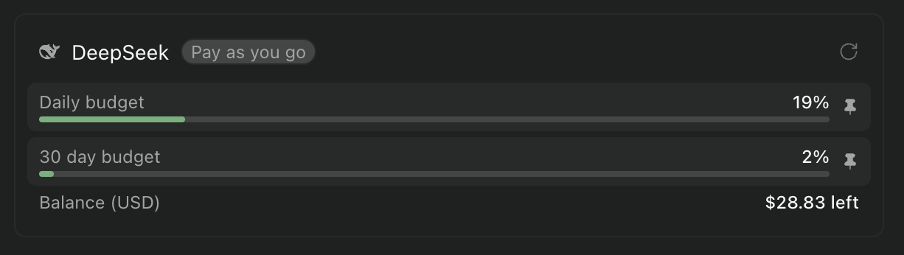
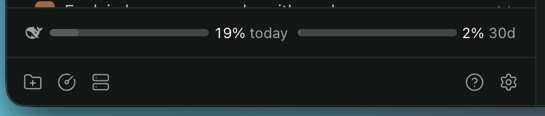

# DeepSeek usage for Paseo

A Paseo plugin that puts your DeepSeek balance in the usage panel beside Claude, Codex, and
the other built in sources, and measures your spend against limits you set.





## Why spend is derived instead of read

DeepSeek publishes a balance for an API key but no usage history. `GET /user/balance` is the
only account endpoint a key can reach, and the console refuses API keys outright:

```console
$ curl -H "Authorization: Bearer $DEEPSEEK_API_KEY" \
    https://platform.deepseek.com/api/v0/users/get_user_summary
{"code":40003,"msg":"Authorization Failed (invalid token)","data":null}
```

The console only accepts the token from a signed in browser session, which expires and which
this plugin never asks you for. There is an open request for a real usage API at
[deepseek-ai/awesome-deepseek-integration#654](https://github.com/deepseek-ai/awesome-deepseek-integration/issues/654).

Rather than invent numbers, the plugin reads the balance and derives spend from the difference
between consecutive readings: a drop is spend, a rise is credit that was added, so a top up is
never mistaken for negative spend. A background tick takes a reading every ten minutes, the
usage panel takes one when it refreshes, and the settings screen reuses the last reading unless
it is more than a minute old.

## Requirements

- Paseo 0.11.2 or later, with plugins enabled. `registerUsageSource` is a 0.11 API.
- A DeepSeek API key in pi's login store, meaning the `deepseek` entry of
  `~/.pi/agent/auth.json` or of wherever `PI_CODING_AGENT_DIR` points, or in the daemon's
  `DEEPSEEK_API_KEY`.

The key is only ever read. pi keeps ownership of rotating it.

## Install

```bash
paseo plugin install github:343max/paseo-deepseek-usage
```

That is the whole install. Paseo compiles the plugin's TypeScript itself, and the modules it
imports at runtime (`@getpaseo/plugin`, `zod`, React Native, React Query) are supplied by the
host, so there is nothing to build and no `npm install`. Pin a branch, tag, or commit when you
want a fixed revision:

```bash
paseo plugin install github:343max/paseo-deepseek-usage --ref main
```

Paseo asks before running plugin code, because backend plugin code is trusted, unsandboxed, and
runs on the daemon machine. To take a new revision later:

```bash
paseo plugin update paseo-deepseek-usage
paseo plugin logs paseo-deepseek-usage
```

### From a local checkout instead

Useful while changing the plugin, since edits are live after a reload:

```bash
git clone https://github.com/343max/paseo-deepseek-usage.git
cd paseo-deepseek-usage
npm install                     # only needed to typecheck and run the tests
paseo plugin install "$PWD"
paseo plugin reload paseo-deepseek-usage
```

## Settings

Open Settings, then Plugins, then DeepSeek usage. The screen opens with your balance, what you
spent today, and what you spent over the last 30 days, above the limits those figures are
measured against. Command K opens the same screen, and a second command opens DeepSeek's own
usage page in your browser.

| Setting | Default | What it does |
| --- | --- | --- |
| Daily limit | no limit | Spend since local midnight as a percentage. This is the window that appears in the sidebar. It resets at your own midnight. |
| 30 day limit | no limit | Spend over the last 30 days, today included, shown in the usage panel. Rolling, so it has no reset date and each new day pushes the oldest one out. |
| Sample interval | 10 minutes | How often the balance is read. |

Limits are amounts in your wallet's own currency, which DeepSeek reports as USD or CNY, so spend
and budget are the same unit and the percentage means something either way.

Neither limit comes from DeepSeek. DeepSeek is prepaid and has no quota of its own, so a card
with no limit configured has no percentage to show and nothing appears in the sidebar. Clearing
a field removes that limit and its window.

## What the numbers can and cannot say

- DeepSeek reports two decimals, so progress towards a limit is accurate to a cent.
- The ledger starts with the first reading, so usage from before installation is not counted.
- A change between two readings is booked to the day of the earlier reading, which is the last
  day the balance was known. A change that spans midnight therefore lands on yesterday and today
  starts clean.
- While the daemon is not running no readings are taken, so a long gap is booked to the day
  before it rather than to the day the daemon returns.
- Days older than the rolling window are dropped, so that window cannot reach further back than
  30 days however long the plugin has been installed.
- The panel states the balance, not the reasons behind it: the settings screen says when the
  last reading was taken.

Readings are kept in `ledger.json` under `$XDG_STATE_HOME/paseo-deepseek-usage/`, or
`~/.local/state/paseo-deepseek-usage/` when that variable is unset. It holds balances, per day
counters, and timestamps, never the key. Delete it to start over. Set
`PASEO_DEEPSEEK_USAGE_STATE_DIR` to put it somewhere else.

Nothing leaves the daemon machine except the request to `api.deepseek.com`.

## Development

```bash
npm run typecheck
npm test

# One opt-in check that hits the real API and reads the real state on this machine.
DEEPSEEK_LIVE=1 npx vitest run tests/live.test.ts
```

`npm test` covers the ledger arithmetic, the settings and ledger migrations, the balance parser
including its timeout, the report shape against Paseo's own protocol schema, and the sampler.
The live check is opt-in because it spends a fraction of a cent and needs a real login.

## Layout

```
paseo-plugin.json     plugin id, display name, and the Paseo version it needs
index.server.ts       registers the usage source, the settings document, the snapshot RPC,
                      and the background sampler
index.client.tsx      the settings screen and two command center items
client/settings.tsx   live balance header, budget form, link to the usage page
shared/               zod contracts and plain values used by both runtimes
server/               balance client, credential store, ledger, sampler, report builder
tests/                vitest, plus the opt-in live check
OVERVIEW.md           the plugin page text for a registry listing
```

## Notes

- Window ids (`budget:day`, `budget:rolling`) and the usage source id
  (`max343-deepseek-usage`) are part of saved pins, so they are stable by design and never
  change meaning underneath a pin. The source id is namespaced rather than the bare vendor name
  on purpose: the daemon rejects a duplicate source id by failing whichever plugin registers it
  second, so `deepseek` would break the moment a bundled DeepSeek source, or another plugin's
  installation, claimed it.
- The settings document has been through three schema versions and the ledger through two. Both
  migrate in place, so an upgraded plugin keeps your limits and the current day's counters.
